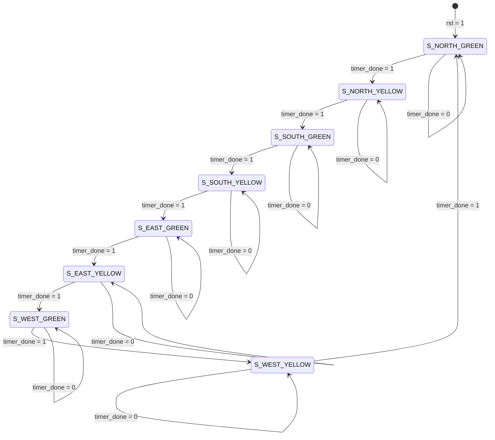

# Finite State Machine (FSM) Design Specification

## 1. FSM Architectural Model

The Four-Way Traffic Light Controller uses an **8-state Moore Finite State Machine**. In a Moore machine, the outputs depend solely on the current registered state (`Output = f(State)`), whereas in a Mealy machine, outputs depend on both the current state and asynchronous primary inputs (`Output = f(State, Inputs)`).

Benefits of Moore FSM for Traffic Light Control:
- **Glitch-Free Outputs:** Transitions do not introduce spurious combinational race conditions on lamp driver lines.
- **Predictable Timing:** All outputs remain strictly stable throughout each clock period.
- **Formal Safety Invariants:** Mutual exclusion of green signals is enforced structurally at the state level.

---

## 2. State Definitions and Encodings

| State Name | Binary Code | Gray Code | Active Direction | Active Lamp | Conflicting Directions | Duration Limit |
| :--- | :---: | :---: | :---: | :---: | :---: | :---: |
| `S_NORTH_GREEN` | `3'b000` | `3'b000` | North | **GREEN** | South, East, West = RED | `GREEN_TICKS` (10) |
| `S_NORTH_YELLOW`| `3'b001` | `3'b001` | North | **YELLOW**| South, East, West = RED | `YELLOW_TICKS` (3) |
| `S_SOUTH_GREEN` | `3'b010` | `3'b011` | South | **GREEN** | North, East, West = RED | `GREEN_TICKS` (10) |
| `S_SOUTH_YELLOW`| `3'b011` | `3'b010` | South | **YELLOW**| North, East, West = RED | `YELLOW_TICKS` (3) |
| `S_EAST_GREEN` | `3'b100` | `3'b110` | East | **GREEN** | North, South, West = RED | `GREEN_TICKS` (10) |
| `S_EAST_YELLOW` | `3'b101` | `3'b111` | East | **YELLOW**| North, South, West = RED | `YELLOW_TICKS` (3) |
| `S_WEST_GREEN` | `3'b110` | `3'b101` | West | **GREEN** | North, South, East = RED | `GREEN_TICKS` (10) |
| `S_WEST_YELLOW` | `3'b111` | `3'b100` | West | **YELLOW**| North, South, East = RED | `YELLOW_TICKS` (3) |

> **Key Design Feature:** In binary encoding, **bit 0 is `1` for all Yellow states** and **`0` for all Green states**. This allows duration selection logic (`duration_sel = current_state[0]`) to synthesize into a single wire with zero logic gate delay!

---

## 3. FSM State Transition Diagram

---

## 4. State Transition Table

| Current State | Input `timer_done` | Next State | `duration_sel` | North Lights | South Lights | East Lights | West Lights |
| :---: | :---: | :---: | :---: | :---: | :---: | :---: | :---: |
| `S_NORTH_GREEN` (`000`) | 0 | `S_NORTH_GREEN` (`000`) | 0 (Green) | `001` (G) | `100` (R) | `100` (R) | `100` (R) |
| `S_NORTH_GREEN` (`000`) | 1 | `S_NORTH_YELLOW` (`001`) | 0 (Green) | `001` (G) | `100` (R) | `100` (R) | `100` (R) |
| `S_NORTH_YELLOW` (`001`)| 0 | `S_NORTH_YELLOW` (`001`) | 1 (Yellow) | `010` (Y) | `100` (R) | `100` (R) | `100` (R) |
| `S_NORTH_YELLOW` (`001`)| 1 | `S_SOUTH_GREEN` (`010`) | 1 (Yellow) | `010` (Y) | `100` (R) | `100` (R) | `100` (R) |
| `S_SOUTH_GREEN` (`010`) | 0 | `S_SOUTH_GREEN` (`010`) | 0 (Green) | `100` (R) | `001` (G) | `100` (R) | `100` (R) |
| `S_SOUTH_GREEN` (`010`) | 1 | `S_SOUTH_YELLOW` (`011`) | 0 (Green) | `100` (R) | `001` (G) | `100` (R) | `100` (R) |
| `S_SOUTH_YELLOW` (`011`)| 0 | `S_SOUTH_YELLOW` (`011`) | 1 (Yellow) | `100` (R) | `010` (Y) | `100` (R) | `100` (R) |
| `S_SOUTH_YELLOW` (`011`)| 1 | `S_EAST_GREEN` (`100`) | 1 (Yellow) | `100` (R) | `010` (Y) | `100` (R) | `100` (R) |
| `S_EAST_GREEN` (`100`) | 0 | `S_EAST_GREEN` (`100`) | 0 (Green) | `100` (R) | `100` (R) | `001` (G) | `100` (R) |
| `S_EAST_GREEN` (`100`) | 1 | `S_EAST_YELLOW` (`101`) | 0 (Green) | `100` (R) | `100` (R) | `001` (G) | `100` (R) |
| `S_EAST_YELLOW` (`101`) | 0 | `S_EAST_YELLOW` (`101`) | 1 (Yellow) | `100` (R) | `100` (R) | `010` (Y) | `100` (R) |
| `S_EAST_YELLOW` (`101`) | 1 | `S_WEST_GREEN` (`110`) | 1 (Yellow) | `100` (R) | `100` (R) | `010` (Y) | `100` (R) |
| `S_WEST_GREEN` (`110`) | 0 | `S_WEST_GREEN` (`110`) | 0 (Green) | `100` (R) | `100` (R) | `100` (R) | `001` (G) |
| `S_WEST_GREEN` (`110`) | 1 | `S_WEST_YELLOW` (`111`) | 0 (Green) | `100` (R) | `100` (R) | `100` (R) | `001` (G) |
| `S_WEST_YELLOW` (`111`) | 0 | `S_WEST_YELLOW` (`111`) | 1 (Yellow) | `100` (R) | `100` (R) | `100` (R) | `010` (Y) |
| `S_WEST_YELLOW` (`111`) | 1 | `S_NORTH_GREEN` (`000`) | 1 (Yellow) | `100` (R) | `100` (R) | `100` (R) | `010` (Y) |

---

## 5. State Encoding Trade-Off Analysis

| Feature | Binary (Dense) Encoding | Gray Code Encoding | One-Hot Encoding |
| :--- | :--- | :--- | :--- |
| **Bit Width ($N$)** | $\lceil \log_2(8) \rceil = 3$ bits | 3 bits | 8 bits |
| **Flip-Flop Count** | **3 Flip-Flops** | 3 Flip-Flops | 8 Flip-Flops |
| **Transitions per Step** | 1 to 3 bits toggle | **Exactly 1 bit toggles** | Exactly 2 bits toggle |
| **Combinational Decode Logic** | Minimal (3 inputs) | Minimal (3 inputs) | None (bit directly drives state) |
| **FPGA Suitability** | Excellent for small FSMs | Reduces dynamic power | Optimal for wide FSMs (>16 states)|
| **Illegal State Coverage** | All $2^3 = 8$ states valid | All 8 states valid | $2^8 - 8 = 248$ illegal states |
